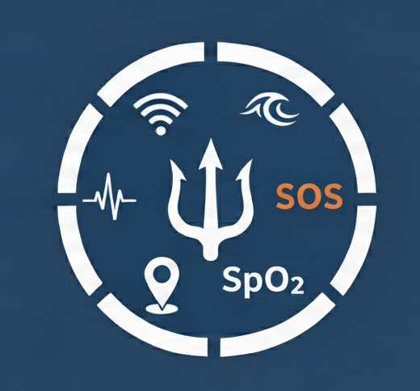
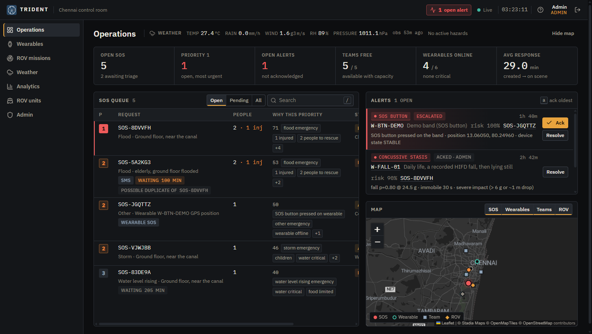
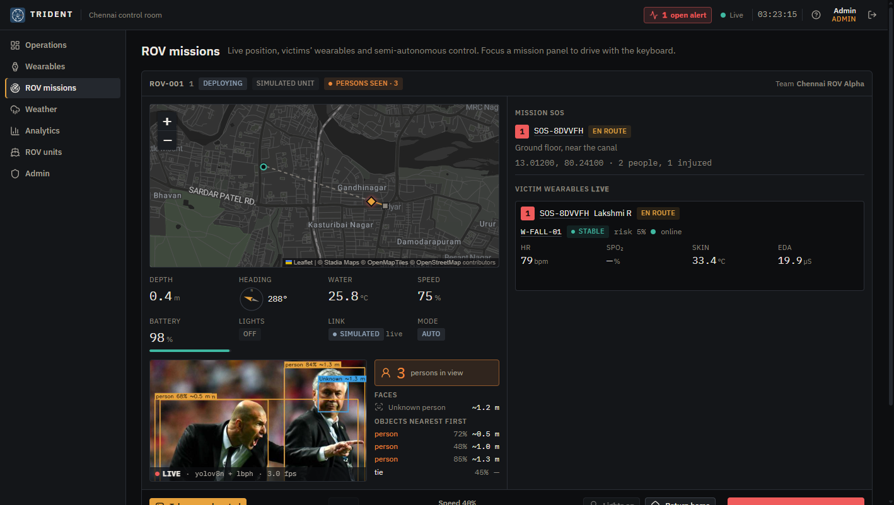
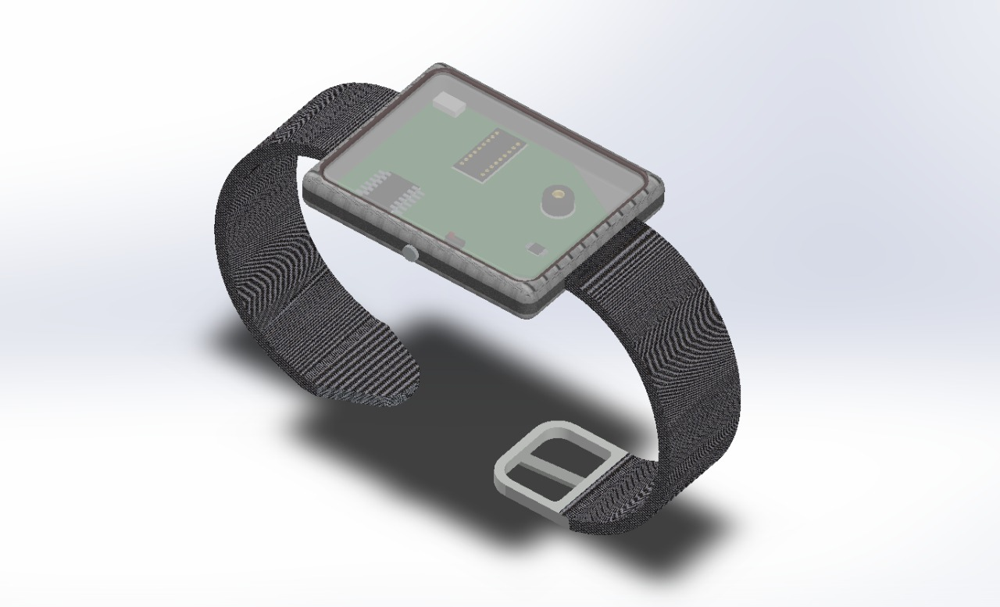
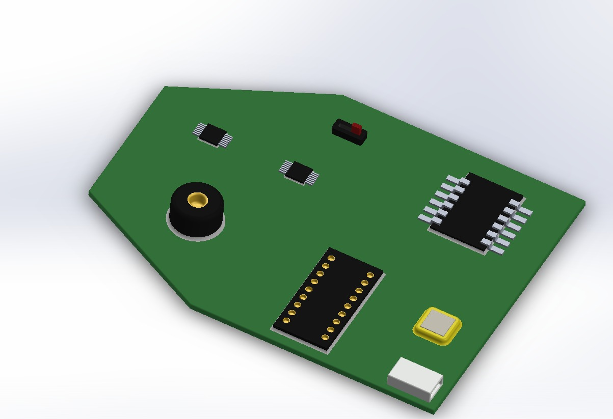
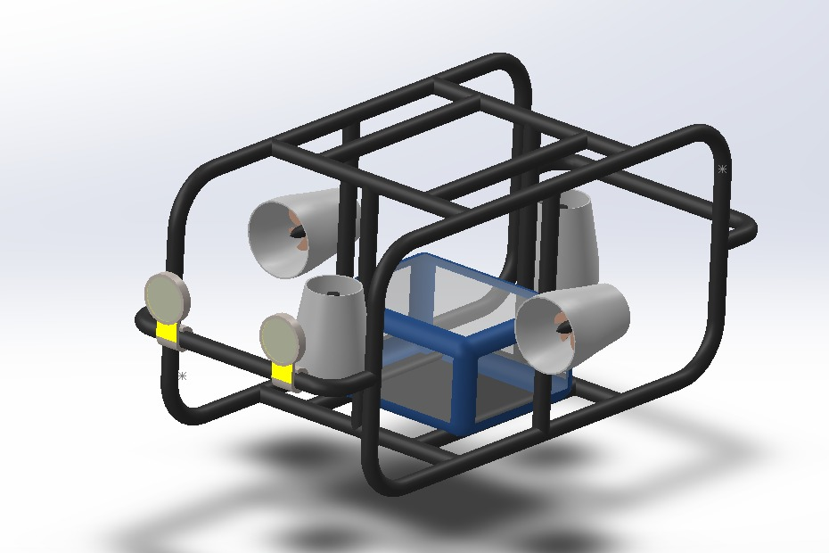
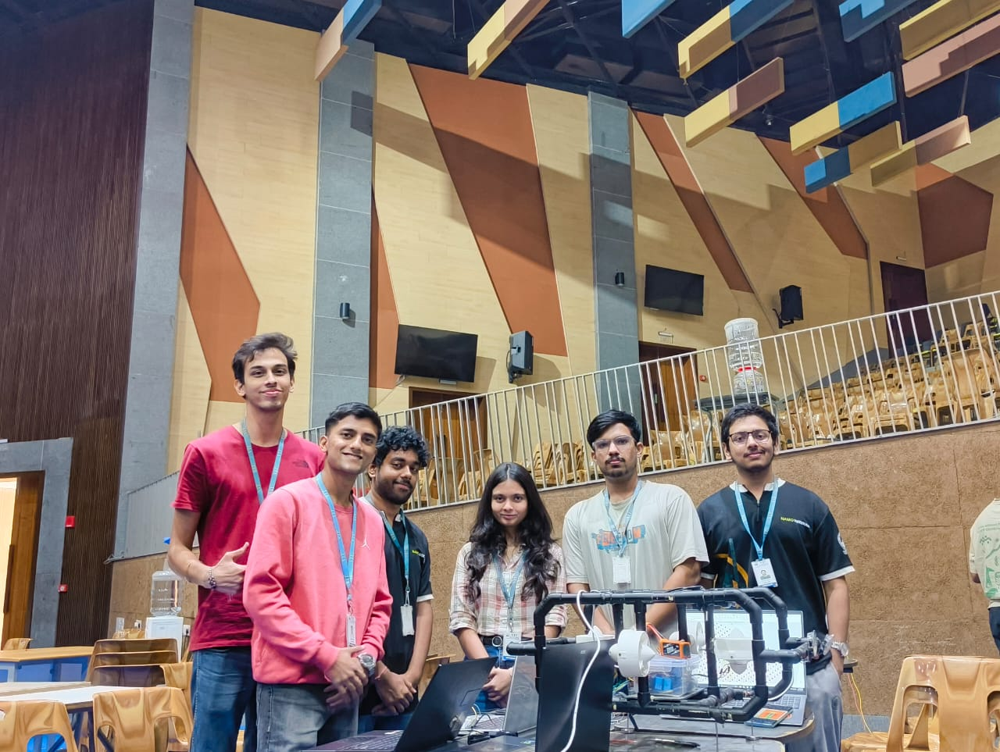

<div align="center">
  
</div>

# TRIDENT: integrated flood and water-rescue platform

[](LICENSE)


TRIDENT connects the people who need rescue with the people who do it.

- **The public** can ask for help from a phone. This works offline (the request is queued) and over plain SMS.
- **A wearable band** streams vitals and motion. On-server ML and a rule-based fusion engine detect falls, entrapment, cardiac and breathing emergencies, and loss of contact. The band also has an SOS button for people without a phone.
- **Dispatchers** work from one live console:
  - a prioritised queue with reasons for each priority
  - team and ROV assignment
  - capacity warnings when teams run out
  - weather and river forecasts
  - analytics on live data
- **ROVs** are semi-autonomous. They can be piloted from the browser, and their camera feed carries live person detection, face recognition and distance estimates.

It is built for Chennai floods and designed to keep working when connectivity fails. TRIDENT is a
decision-support tool, not a certified medical device.

<div align="center">
  
</div>

## What's inside

| Part | Highlights |
|---|---|
| **Public SOS** | Offline-capable PWA, SMS fallback (`SOS <lat>,<lng> P<people> I<injured> T<type>`), tracking link, duplicate detection |
| **Dispatch** | 0–100 triage score with reasons → P1 (most urgent) to P5; priority ageing; urgency-ordered auto-dispatch; capacity banner with human-confirmed team moves; automatic moves only in extreme cases; optimistic locking |
| **Wearable ML** | 5 Tier-1 heads trained on real public datasets (stress, fall, activity, HR-trust, rhythm), each chosen by a subject-grouped model tournament, calibrated and exported to ONNX. A Tier-2 fusion state machine validated on real-data false-alarm replays |
| **Weather** | Multi-variable p10/p50/p90 forecasts to 48 h (LightGBM + GRU) that beat persistence at every horizon; heat, heavy-rain, wind and flood-risk hazards; GloFAS river discharge |
| **ROV** | Autonomous transit, exclusive manual control, dead-man stop, a serial bridge to real units, a 1 Hz track, and a live YOLOv8n + LBPH camera feed |
| **Firmware** | ESP32 band firmware 2.2.0: 1.5 s frames, an 8 min offline queue that keeps event frames, batched idempotent upload, SOS button, buzzer patterns |
| **Platform** | FastAPI, SQLAlchemy + Alembic (SQLite or PostgreSQL), JWT with rotating refresh tokens, RBAC, WebSocket push, leader-elected background jobs, audit log, rate limits, `/readyz` and `/metrics` |

<div align="center">
  
</div>

## Quick start

```bash
pip install -r requirements.txt                       # or requirements-prod.txt to serve only
(cd src/frontend/web && npm ci && npm run build)      # build the console
python app.py                                         # http://localhost:8000
python -m src.backend.app.tools.simulate --with-sos   # optional: live virtual wearables
```

Demo logins (local only): `admin`, `dispatcher`, `responder`, `viewer`. The password for all four is
`trident-demo-2026`.

The full setup is in [docs/GETTING_STARTED.md](docs/GETTING_STARTED.md). It covers the camera worker,
connecting real hardware, and configuration.

## Documentation

| | |
|---|---|
| [Architecture](docs/ARCHITECTURE.md) | Components, data flows, design principles, repository layout |
| [Getting started](docs/GETTING_STARTED.md) | Install, run, demo, tests, hardware, configuration |
| [User guide](docs/USER_GUIDE.md) | The console for each role, ROV piloting, the band |
| [Deployment](docs/DEPLOYMENT.md) | Production checklist, Docker Compose, PostgreSQL, backups |
| [Platform design and API](docs/PLATFORM_DESIGN.md) | API contract, consistency/availability (CAP), transactions, auth, scheduling, WebSocket |
| [Wearable ML architecture](docs/WEARABLE_ML_ARCHITECTURE.md) | Heads, tournament, fusion, decisions |
| [Training guide](docs/TRAINING_GUIDE.md) | Rebuild every model from raw data |
| [Weather model](docs/WEATHER_MODEL.md) | Data, method, backtests |
| [Resilience and roadmap](docs/RESILIENCE_AND_FUTURE_WORK.md) | Degraded conditions, fallbacks, future work |
| [All documentation](docs/README.md) | The full index, including generated reports |

Component READMEs: [backend](src/backend/README.md), [web console](src/frontend/web/README.md),
[firmware](src/firmware/README.md), [computer vision](src/cv/README.md).

## Hardware

<div align="center">
  
  
  
</div>

| Device | Parts |
|---|---|
| Wearable band | ESP32 with MPU6050 (motion), MAX30102 (PPG), MAX30205 (skin temperature), BMP388 (pressure), Grove GSR, water contact, NEO-6M GPS, buzzer and SOS button (wiring in the [firmware README](src/firmware/README.md)) |
| ROV | Serial-controlled thrusters and lights, plus a camera for the vision worker |

There is a demo video of the wearable at [assets/videos/wearable-demo.mp4](assets/videos/wearable-demo.mp4).

## Repository layout

```
app.py                 server entry point
src/backend/app/       FastAPI command server (+ migrations in src/backend/migrations)
src/frontend/web/      React operations console and public PWA
src/ml/wearable/       wearable data pipeline, model tournament, export, serving runtime, fusion
src/ml/weather/        weather forecasting
src/firmware/          ESP32 band firmware (PlatformIO)
src/rov/               ROV serial bridge
src/cv/                ROV vision worker and face enrolment
models/                exported models, registries, model cards
tests/                 backend and ML test suites
docs/                  documentation (generated reports in docs/reports/)
```

## Status

Development phases P0–P8 are complete. The full QA round covered functional, accessibility,
security, load and failure-injection testing, and all 128 automated tests pass. The roadmap for future
versions is in [docs/RESILIENCE_AND_FUTURE_WORK.md](docs/RESILIENCE_AND_FUTURE_WORK.md).

## Team



## License

MIT; see [LICENSE](LICENSE).

> **In a real emergency, call local emergency services first.** In India: 112 (emergency), 108 (ambulance),
> 101 (fire), 100 (police), 1070 (Tamil Nadu State Emergency Operation Centre).
