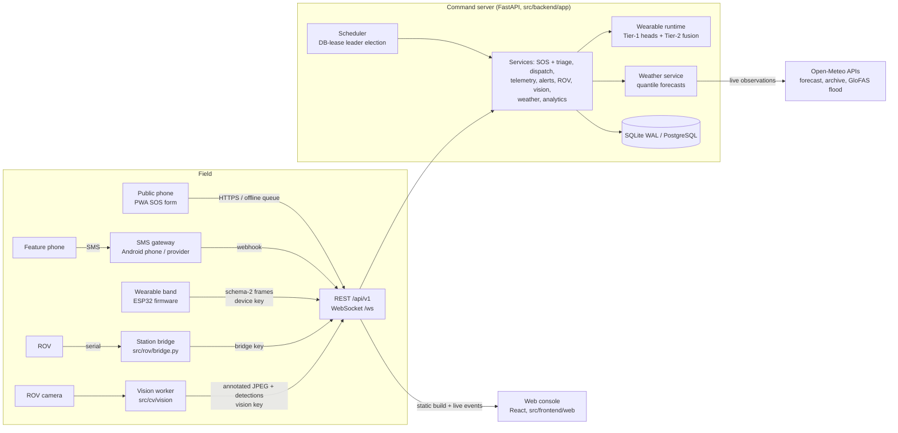

# TRIDENT system architecture

TRIDENT coordinates flood and water rescue. The public asks for help, wearables report the people
who wear them, rescue teams and ROVs are dispatched, and a control room sees all of it live.

This document is the map. Each component has its own detailed document, linked from its section.

## 1. Components



| Component | Code | What it does | Docs |
|---|---|---|---|
| Web console | `src/frontend/web` | Public SOS form (offline-capable PWA), tracking, and the staff console: operations, SOS detail, wearables, ROV missions, weather, analytics, admin | [User guide](USER_GUIDE.md), [web README](../src/frontend/web/README.md) |
| Command server | `src/backend/app` | REST API, WebSocket push, auth, dispatch, telemetry ingest, alerts, background jobs | [Platform design and API contract](PLATFORM_DESIGN.md), [backend README](../src/backend/README.md) |
| Wearable ML | `src/ml/wearable` | Data pipeline, 5 Tier-1 heads (stress, fall, activity, HR-trust, rhythm), Tier-2 fusion state machine, serving runtime | [Wearable ML architecture](WEARABLE_ML_ARCHITECTURE.md), [training guide](TRAINING_GUIDE.md), [reports](reports/) |
| Weather | `src/ml/weather` | Multi-variable p10/p50/p90 forecasts to 48 h, hazards, flood-risk index | [Weather model](WEATHER_MODEL.md) |
| Wearable firmware | `src/firmware` | ESP32 band: sensors, 1.5 s frames, offline queue, SOS button, buzzer, local web UI | [Firmware README](../src/firmware/README.md) |
| ROV | `src/rov` | Serial bridge between a physical ROV and the server (station protocol); legacy desktop console | [User guide §ROV](USER_GUIDE.md) |
| ROV vision | `src/cv` | YOLOv8n detection, Haar + LBPH faces, distance estimates on the ROV camera | [CV README](../src/cv/README.md) |
| Simulator | `src/backend/app/tools/simulate.py` | Streams real recorded sessions as virtual wearables, for demos and tests | [Getting started](GETTING_STARTED.md) |

## 2. Main data flows

### 2.1 Help request to rescue

1. A request arrives by one of three routes:
   - the web form, offline-queued if there is no connection and sent with an `Idempotency-Key`
   - an SMS through the gateway webhook
   - the band's SOS button
2. Triage scores it 0–100 with human-readable reasons and maps the score to P1 (most urgent) to P5. It checks for duplicates (same phone, or within 100 m in the last 2 h).
3. Every 10 s the scheduler re-triages open requests:
   - waiting time ages a request upward
   - a verified linked wearable's state adds to its score
   - free teams are handed out in order of urgency
4. If no team is free:
   - the request is flagged `awaiting_resources`
   - the capacity banner suggests moving a team from a lower-priority request
   - in the extreme case (every signal agrees a life is at immediate risk) the move happens automatically
5. The dispatcher assigns a team or ROV. Status moves pending → triaged → assigned → en route → on scene → resolved, with optimistic locking at every step.

### 2.2 Wearable to alert

1. The band sends a schema-2 frame every 1.5 s, buffering up to 8 min offline.
2. Ingest authenticates the device key and de-duplicates on (device, boot, seq).
3. The per-device runtime runs the feature engine, then the five calibrated Tier-1 heads, then the Tier-2 fusion state machine. This happens outside the write transaction.
4. A change of state is stored. A critical state opens an alert linked to the person's verified SOS, and silence while not stable opens `LOST_CONTACT`.
5. WebSocket events update the console within about a second.

### 2.3 ROV mission

1. A dispatcher deploys a ROV to a request; it navigates to the target in auto mode.
2. A dispatcher can take exclusive manual control. STOP is always available. A dead-man stop cuts thrust after 120 s without a command, and the bridge stops the thrusters if it loses the server for 5 s.
3. The bridge exchanges telemetry and commands with real units; simulated units are moved by a 1 Hz job.
4. The vision worker streams annotated frames; staff open them with a single-use ticket.

## 3. Design principles

Detailed in [PLATFORM_DESIGN.md](PLATFORM_DESIGN.md) §1.

- **Consistency vs availability (CAP):** dispatch state is consistency-first (ACID transactions, optimistic locking, a server-side state machine). Telemetry is availability-first (offline buffers, idempotent ingest). Live push is best effort, and clients resync from REST on a sequence gap.
- **Security:**
  - Staff log in with short-lived JWTs and rotating refresh tokens with reuse detection.
  - Every role check (RBAC) re-reads the role from the database.
  - Devices, ROV bridges and vision workers each authenticate with their own hashed key.
  - Public endpoints are rate-limited.
  - Every write is audited.
- **Graceful degradation:** the API runs without ML, weather or internet. Only the database is required, and `/readyz` reports what is missing.
- **Training equals serving:** the same feature engine code builds the training windows and serves live frames. Models ship as ONNX and are parity-checked; tree ensembles also ship as compiled numpy forests that load in 0.5 s.

## 4. Repository layout

```
app.py                      entry point (uvicorn)
src/backend/app/            FastAPI app: api/, services/, models.py, db.py, jobs.py, realtime.py, tools/simulate.py
src/backend/migrations/     Alembic revisions (SQLite + PostgreSQL)
src/frontend/web/           React + Vite + TypeScript console (built to dist/, served at /)
src/ml/wearable/            data, emulator, features, heads, tournament, final (export), serving (runtime, fusion, replay)
src/ml/weather/             weather data, models, backtests, serving
src/firmware/               ESP32 PlatformIO project (wearable band)
src/rov/                    ROV serial bridge + legacy desktop console
src/cv/                     vision worker (src/cv/vision) + face enrolment scripts
models/                     exported models with registries and model cards (wearable/, weather/)
data/                       raw (zipped datasets), processed (frames, head tables, replays), databases (local SQLite)
tests/                      backend/ and ml/ test suites (pytest)
docs/                       this documentation; generated reports in docs/reports/
scripts/deployment/         local start scripts
```

## 5. Technology

| Layer | Choices |
|---|---|
| Backend | Python 3.11+, FastAPI, SQLAlchemy 2, Alembic, PyJWT, bcrypt, httpx |
| Data | SQLite (WAL) locally; PostgreSQL in production |
| ML serving | onnxruntime, numpy compiled forests, LightGBM (weather) |
| ML training | scikit-learn, XGBoost, LightGBM, PyTorch (1D-CNN, GRU), MiniRocket (numpy), Optuna, MLflow |
| CV | ultralytics YOLOv8n, OpenCV contrib (Haar + LBPH) |
| Frontend | React 18, Vite, TypeScript, uPlot, Leaflet (Stadia dark tiles), service worker |
| Firmware | ESP32 (Arduino / PlatformIO, FreeRTOS); MPU6050, MAX30102, MAX30205, BMP388, GSR, GPS |
| External data | Open-Meteo (forecast, archive, GloFAS flood API) |

## 6. Where to go next

| Goal | Read |
|---|---|
| Run it locally | [GETTING_STARTED.md](GETTING_STARTED.md) |
| Use the console or the band | [USER_GUIDE.md](USER_GUIDE.md) |
| Deploy to a server | [DEPLOYMENT.md](DEPLOYMENT.md) |
| Integrate with the API | [PLATFORM_DESIGN.md](PLATFORM_DESIGN.md) |
| Train or retrain models | [TRAINING_GUIDE.md](TRAINING_GUIDE.md), [WEARABLE_ML_ARCHITECTURE.md](WEARABLE_ML_ARCHITECTURE.md), [WEATHER_MODEL.md](WEATHER_MODEL.md) |
| Known limits and the roadmap | [RESILIENCE_AND_FUTURE_WORK.md](RESILIENCE_AND_FUTURE_WORK.md) |
| Project history, datasets and decisions | [WEARABLE_ML_SUBPROJECT_CONTEXT.md](WEARABLE_ML_SUBPROJECT_CONTEXT.md) |
